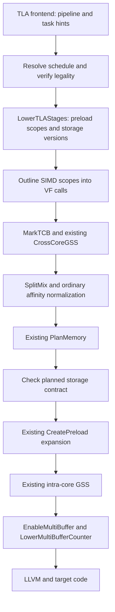

# TLA pipeline/task 的设计复核与最小后端方案

> 本文保留为修改前的静态评审快照。后续固定 stage 接口、独立性责任和已实施修改以
> [修改记录](tla_pipeline_1107_changes.md)及[当前接口](tla_scope_schedule_v2.md)为准。

日期：2026-11-07。分析对象：`triton-ascend:dev/tla-pipeline-1107`、配套 `AscendNPU-IR:tla-pipeline-1107`，以及 FA8 用例和 2026-11-06 的 pass dump。

本文给出源码与已有 IR 的静态复核、建议合同和实施步骤。本轮只编写分析文档，没有修改编译器或 kernel，没有重新构建、跑 lit、上卡或执行 simulator。文中的“已观察”指源码或日志直接支持；“建议”指待实现方案；“待验证”不能当作已经发生的误编译或性能回退。

## 1. 结论与建议方向

**当前方向基本正确：把 TLA 的任务安排转换成既有 preload 正规形，复用内存规划、跨核/核内同步和多缓冲物化。需要继续收敛的是前端到该正规形的合同，而不是再建立一套 TLA 专用的 CreatePreload 或 SyncSolver。**

对“CreatePreload 是否有不必要 hack”的判断需要区分最终代码与中间实验版本。最终提交 `4600c7185` 相对本轮 stage 功能之前的 `14e978e34`，没有修改 CreatePreload 的循环展开主体、地址旋转、counter 克隆或上界公式；没有修改 PlanMemory 和 GraphSyncSolver 目录。保留的是入口过滤、一般输入校验、部分展开时的标记清理保护，以及允许 AIV 使用该 pass 的声明变化。因此，不建议直接回退整个 CreatePreload 改动。

当前最需要修的是以下几件事：

1. **明确调度的语义合法性由谁保证。** 最终 LowerTLAStages 检查 stage 非递减、scope/alloc/effect 形态，却已经删除 GM 跨迭代独立性证明。原有同步求解器不能自动使一个违反数据依赖的时间安排变合法。
2. **保持逻辑 stage、存储版本数、事件协议三个概念独立。** FA 两阶段不等于所有 buffer 都必须双缓冲，也不等于必须分配两个不同 flag ID。
3. **修好 IR 正规化与验证边界。** 域内 helper 的搬移存在 dominance 边界漏洞；非 Read/Write effect 不能统一放行；规划后检查不应把“有地址”当成“版本合同正确”。
4. **先解除不必要的源码存储绑定，再判断是否需要复杂后端优化。** FA 当前把 K/V 和 QK/PV 绑定在同一 root，是合法但较强的约束。独立逻辑 allocation 更适合“用户控制任务，编译器控制物理存储”的目标。
5. **最终源码必须重新生成一条可追溯的编译和设备验证链。** 给定 dump 仍有 `hivm.preload_fixed_depth`，最终代码已改为 `hivm.preload_pipeline`；已有产物不能作为最终提交通过的证据。

推荐最小实现范围是：前端发出清晰任务 IR；LowerTLAStages 完成受限但可信的准入、正规化、版本计划和 preload 转换；pipeline builder 负责选择调用范围；其他 pass 只遵守通用 preload/VF/memory-effect 合同。自动 stage 分配应在这一边界之前实现，并与手工 stage 共用后半条编译链。

## 2. 版本、证据与分析范围

### 2.1 锁定的源码

| 对象 | 本次读取的版本 | 说明 |
| --- | --- | --- |
| triton-ascend | `efa0a959c32621e1a37c54eb618533ed92e022c6` | 当前分支 `dev/tla-pipeline-1107`；主要接口改动在 `a36e1df22`，builder 支持还涉及此前提交 |
| AscendNPU-IR 子模块 | `4600c718588cebc33c5b3eb2cd51d94fe127cb98` | 与 triton-ascend gitlink 一致；子模块是 detached HEAD |
| 独立 AscendNPU-IR 工作区 | 同上 | `/Users/ayame/workspace/AscendNPU-IR` 的 `tla-pipeline-1107` 指向相同提交 |
| stage 功能差异基线 | `14e978e34` | 位于首个 LowerTLAStages 提交 `02514228b` 之前；用于隔离本轮功能改动 |

没有 fetch 或切换分支，不声称这些引用是远端最新状态。工作开始时 triton-ascend 的 `.gitignore` 已有用户修改，本轮没有改动它。

旧文档使用过 `9780591de` 作为基线。从该提交到最终分支还有大量无关主线变化，不能把它们统称为 TLA pipeline 侵入。本文关于“本轮未改 PlanMemory/SyncSolver”的结论基于 `14e978e34..4600c7185`。

### 2.2 已有产物能证明什么

主证据是 [fa_pipeline_passdump.log][dump]，共 26,838 行，SHA-256：

```text
8303c3a55c32764621098f8d30969e75ca5c83abbe37c7730dcbe34470c85e1e
```

当前 [fa_pipeline_kernel.py][kernel] SHA-256：

```text
1d939ec9c00b36e34d0f85b0aaf63eefd9608efbb08bc82144f90a369579f8c1
```

已通过文本匹配核实三个摘录直接来自主 dump：

| 摘录 | dump 起始行 | 对应状态 |
| --- | ---: | --- |
| [03_lower_tla_stages.mlir][ir-lower] | 836 | LowerTLAStages 后 |
| [03b_create_preload.mlir][ir-preload] | 4700 | CreatePreload 后 |
| [04_final_hivm_ir.mlir][ir-final] | 9603 | MarkDisableLoad 后、ConvertHIVMToStandard 前 |

dump 中出现 `preload_fixed_depth` 23 次，`preload_pipeline` 0 次。最终源码只产生后者。这是明确的版本差异；仅凭日志不能准确反推出使用了哪个源码 SHA 或哪些未提交补丁。

[build.log][build-log] 有 `BUILD PASS`，列出了 40,544 字节的 npubin；[02_npuir.log][npu-log] 有 C/C++ 后端与链接步骤。这支持“当时环境完成了该用例编译”，但没有提供最终提交对应的完整编译器身份、精度、死锁检查和性能验收。目录名含 msprof 也不意味着这些文件本身就是执行流水 trace。

这份 dump 主要是 **After-pass** 输出。后文用相邻阶段还原变化，不称其为包含所有 Before/After 的完整重放记录。

## 3. 应固定下来的用户语义

### 3.1 pipeline 表达迭代交错，task 表达工作边界

建议保留当前 Python 外形：

```python
for k in tla.pipeline(T):
    scratch = tla.alloc(...)
    with tla.scope.cube().task("produce", stage=0):
        ...
    with tla.scope.vector().task("consume", stage=1):
        with tla.scope.simd():
            ...
```

一个逻辑迭代 `k` 对应一次完整工作；task 是该工作的一个执行片段。stage 指定该片段相对于流水 tick 的偏移。令 `s(task)` 为 stage，则：

```text
执行 task(k) 的 tick = k + s(task)
在 tick n，task 使用的逻辑迭代 k = n - s(task)
task 有效条件：0 <= k < T
```

stage 不是硬件 pipe 编号，不是任务名的序号，不是一个 task 内指令的延迟，也不保证同 stage 的工作同时完成。Cube task 可含 MTE2、MTE1、M、FIX 等多个 pipe；vector task 可含 VF 与搬运。异步完成和存储复用仍由同步处理。

当前固定 stage 后端保持源码任务顺序，要求 stage 沿源码非递减。同 stage 多 task 合法且都必须保留。这个限制是首版实现边界，不是软件流水的普遍定律。

### 3.2 stage 与 order 必须有可解释的优先级

当前前端允许省略 stage/order，也会透传 `hivm.task_order`；最终 LowerTLAStages 仍要求每个 task 有 stage，且没有实现 order 排序。不能把“Python 接口接受”解释为“后端已经自动调度”。

建议语义为：显式 stage 是用户要求兑现的安排；order 是在依赖和资源约束允许时使用的排序偏好。若希望提供可被自动修改的 stage 偏好，应另外设计清楚的模式，不能悄悄改变既有 `stage=` 的含义。

在自动调度实现以前，缺 stage 应给明确诊断；非空 order 至少应有“当前后端未使用”的 remark，或在严格模式下拒绝。现在静默透传、不使用、不保证保留，容易让调参结果不可解释。

### 3.3 不含 SSA carry，不等于没有跨迭代依赖

当前前端拒绝 pipeline 的 SSA loop-carried 值，这是必要的简化，但内存本身也能承载递推。例如：

```text
task load, stage 0:  temp(k) = X[k]
task store, stage 1: X[k+1] = f(temp(k))
```

顺序循环要求 `store(k) -> load(k+1)`。交错后，两者都位于 tick `k+1`，而源码顺序先执行 load，违反原依赖。双缓冲 temp 不能修复 X 上的递推；在错误顺序中添加 wait 也不构成合法的调度算法。

一般地，对边 `A(k) -> B(k+d)`，必须满足：

```text
s(A) <= d + s(B)
```

等号时还需保证同 tick 的发射顺序及跨核完成协议。该式只表达依赖时间方向，不替代完整同步分析。第一版可以只接受无跨迭代真依赖的工作，不必实现一般 modulo scheduling；但必须证明这一点，或者在 API 中明确建立并验证可用的独立性合同。

## 4. 从 FA8 看任务、数据流与源码约束

### 4.1 这个例子确实适合作为第一条流水闭环

FA 外部规格是 B4/H8/S1024/D64，BM=16，两个 AIV 各处理 VM=8 行。每次逻辑迭代处理一个 query tile，并一次性覆盖全部 1024 个 key。这样消除了分块 online softmax 的 `m/l/acc` 跨 KV 迭代递推。

总 query tile 数为 2048，28 个 program 采用 `tile = core + 28*k`。core 0..3 各处理 74 个 tile，core 4..27 各处理 73 个，合计 2048。对于合法 k，这一映射完整且不重复。`head=tile//64`，`row=(tile%64)*16`；两个 AIV 分别输出 `row..row+7` 和 `row+8..row+15`。host 为 O/MAXIMUM/DENOMINATOR 单独分配输出，而 Q/K/V 只读，因此该调用方式下不同 tile 的输出互不重叠。

这是对**这个 kernel 加 host wrapper**的证明，不能由此推导任意 GM view 或任意调用者都安全。后端如果依赖 ABI 的 noalias 承诺，需要明确记录承诺来源。

### 4.2 七个 task 的作用

| task | 核 | stage | preload_num，P=2 | 输入与输出 |
| --- | --- | ---: | ---: | --- |
| load_qk | Cube | 0 | 1 | Q/K 的 GM view → q_l1、kv_l1 |
| qk | Cube | 0 | 1 | QK → product_l0c → 两个 AIV 的 score |
| load_v | Cube | 1 | 0 | V 的 GM view → kv_l1，覆盖该 epoch 的 K |
| softmax | Vector | 1 | 0 | score → maximum、denominator、probability |
| publish_probability | Vector | 1 | 0 | 各 AIV 的 probability → p_l1 的对应行分片 |
| pv | Cube | 1 | 0 | p_l1 × kv_l1 → pv_l0c → 两个 AIV 的 numerator |
| output | Vector | 1 | 0 | numerator/denominator → O，并写 max/sum 的八份副本 |

用逻辑 tick 展示期望行为：

| tick | stage 0 | stage 1 |
| ---: | --- | --- |
| 0 | load_qk(0)、qk(0) | 无 |
| 1 | load_qk(1)、qk(1) | load_v(0)、softmax(0)、publish(0)、pv(0)、output(0) |
| 2 | load_qk(2)、qk(2) | 完成 query 1 |
| T−1 | 开始最后一个 query | 完成 query T−2 |
| T | 无 | 完成 query T−1 |
| T+1 | 无 | 无算法工作；当前通用展开仍保留此 tick |

此表是逻辑安排，不是测得的硬件时间线。AIC 与 AIV 可按同步关系推进，不要求每个 tick 形成全局 barrier。尤其 AIC 同时承担 QK、PV 和搬运，不能从表格直接宣称两阶段可带来两倍速度。

### 4.3 buffer 版本数的正确含义

最终 LowerTLAStages 对每个循环内 alloc 沿 ViewLike 链收集访问 stage，采用：

```text
P = max(stage) + 1
N(root) = last_stage(root) - first_stage(root) + 1
```

未发现访问时取 1。这里统计 read/write 等内存访问触及的 root，不是按 task 数计数。公式是在独立 epoch、固定 stage 与正确同步前提下，对 stage 生命周期区间的保守版本计划；它不是一般带分支、递推、异步逃逸情形的完整存储定理。

| root | stage 区间 | N | 单份大小 | 判断 |
| --- | --- | ---: | ---: | --- |
| q_l1 | 0..0 | 1 | 2 KiB | load_qk→qk；复用仍需核内 WAR 保护 |
| kv_l1 | 0..1 | 2 | 128 KiB | K/V 手工共用 root，跨度扩大 |
| p_l1 | 1..1 | 1 | 32 KiB | 两 AIV 发布→AIC PV；需要 ready/free |
| product_l0c 及 pv_l0c view | 0..1 | 2 | 64 KiB | 整个 root 双版本，PV 只使用其中 4 KiB |
| score | 0..1 | 2 | 每 AIV 32 KiB | QK Fixpipe→softmax，是实际跨阶段通道 |
| probability | 1..1 | 1 | 每 AIV 18 KiB | 包含每行 stride padding |
| maximum、denominator | 1..1 | 各 1 | 各 32 B | softmax→output，同阶段多任务传值 |
| numerator、output | 1..1 | 各 1 | 2 KiB、1 KiB | PV→VF→GM |
| 两个 stats copies | 1..1 | 各 1 | 各 256 B | output 内生成并写 GM |

源码显式数组按此策略合计：L1 **290 KiB**，L0C **128 KiB**，UB **每 AIV 85.5625 KiB**。dump 中可见地址的末端与这些数值一致，但这不是包含模板内部临时量、VF 栈和全部对齐开销的最终资源报告。

旧 FA README 的“每个 root 两版本”预算已经不对应最终策略。日志目标设备规格也应从该产物读取，不能套用其他 Ascend 型号的容量来判断越界。

单槽仅表示不因 stage 跨度增加版本，**不表示用户可依赖上一 epoch 留下的状态**。循环内 scratch 每个 epoch 都应按其算法先初始化再读取；物理地址常驻与逻辑数据持久是两个不同合同。

### 4.4 这两处手工复用应优先做 A/B

当前写法没有明显违反 resultless task、VF 嵌套、alloc 归属等结构规范。`pv_l0c` 是 product_l0c 的 view，也正确表达了别名。但是，它把本可以独立规划的数学值提前绑定到了同一存储根。

建议第一个源码实验仅拆 allocation，不改 stage 和数学运算：

```python
k_l1 = tla.alloc(..., space="l1")
v_l1 = tla.alloc(..., space="l1")
qk_l0c = tla.alloc((S // 16, BM // 16, 16, 16), tl.float32, space="l0c")
pv_l0c = tla.alloc((D // 16, BM // 16, 16, 16), tl.float32, space="l0c")
```

在当前 stage-span 策略下，K、V 各一份，总 L1 字节数与共享 root 的两份相同。QK 和 PV 各一份，则 L0C 从 128 KiB 降到 **68 KiB**，也减少了显式别名带来的依赖关系。这是字节预算与 IR 复杂度的改进预期，不是已经测得的提速。

score 的两份不能按同样理由删掉：它实际承载 stage 0 到 stage 1 的数据。p_l1 的单份会使下一次 publish 等待上一次 PV 读取结束，可能限制跨 tick 的推进；是否主动增加其版本属于后续性能策略，不能把“stage span 的最小保守槽数”理解为性能最优。

如果最终仍想支持用户明确共享存储，当前 view 方式可以保留为可选优化和别名回归用例。主教学用例宜首先使用独立逻辑 buffer，让编译器决定物理复用，而不是为少几个 alloc 引入更长的流水生命周期。

## 5. 关键 IR 阶段应该做什么，以及日志实际上做了什么

### 5.1 前端与 ttadapter：保留逻辑边界

当前 `_TLACodeGenerator` 只扩展 TLA 的 for lowering，复用普通 Triton 的其他循环；`create_tla_pipeline` 在域外生成 index bounds，在域内建立 resultless `scf.for`，并向 Python 暴露 i64 逻辑 IV。这是合适的侵入边界。

期望输入形态如下，省略具体算子类型：

```mlir
scope.scope : () -> () {
  scf.for %k = %c0 to %T step %c1 {
    %score = memref.alloc() : ...
    scope.scope : () -> () {
      // QK + Fixpipe
      scope.return
    } {hivm.task_name = "qk", hivm.pipeline_stage = 0 : i32,
       hivm.tcore_type = #hivm.tcore_type<CUBE>}
    scope.scope : () -> () {
      scope.scope : () -> () {
        // AVE row/chunk loops
        scope.return
      } {outline, hivm.vector_function, ...}
      scope.return
    } {hivm.task_name = "softmax", hivm.pipeline_stage = 1 : i32,
       hivm.tcore_type = #hivm.tcore_type<VECTOR>}
  }
  scope.return
} {hivm.pipeline}
```

GM 应尽量保持“参数 root + typed memref view + 显式 offset/stride”的 provenance；不要为了地址计算方便把它过早变成无法追溯的裸整数 pointer_cast。当前 FA 的 canonicalized 输入是参数上的 `memref.reinterpret_cast`，不是一个必须靠不透明 GM 指针放宽才能通过的例子。

`enable_preload=False` 是用户关闭通用自动 preload 选择的选项；本用例显式请求 `tla.pipeline`，其物化由 affinity builder 接入，不受该布尔值等价控制。应在文档说明这两个层次。类似地，metadata 的 `enable_tla_mode=false` 不能单独证明没走 TLA；该路径还通过模块 `hacc.mode="tla"` 选择。判断应以实际模块和执行 pass 链为准。

### 5.2 LowerTLAStages：转换安排，不提前展开时间

日志行 836 后能看到七个 task 都转换成 preload scope，其中两个 `preload_num=1`、五个 `preload_num=0`，均 `max_preload_num=2` 且 `no_inline`。alloc 获得上一节列出的 N 及 `preload_local_buffer`、`mem_unique`。循环此时仍是 `[0,T)`，没有 guard、没有 `k-1` 时间展开。

最终代码对应输出应为：

```mlir
scf.for %k = %c0 to %T step %c1 {
  %score = memref.alloc() : ...
  annotation.mark %score {hivm.multi_buffer = 2 : i32,
                         hivm.preload_local_buffer, mem_unique} : ...
  scope.scope : () -> () {
    // QK(k) + Fixpipe(k)
    scope.return
  } {hivm.max_preload_num = 2 : i32, hivm.preload_num = 1 : i32,
     hivm.tcore_type = #hivm.tcore_type<CUBE>, no_inline}
  scope.scope : () -> () {
    // softmax(k), still in its SIMD scope
    scope.return
  } {hivm.max_preload_num = 2 : i32, hivm.preload_num = 0 : i32,
     hivm.tcore_type = #hivm.tcore_type<VECTOR>, no_inline}
} {hivm.preload_pipeline}
```

旧日志最后一行是 `hivm.preload_fixed_depth = 2`；不能照抄旧标记作为最终版的输出要求。stage 到 preload 的方向为：

```text
preload_num = P - 1 - stage
```

这里的反向编号用于适配已有展开器，前端无需接触。task 名当前被删除；建议在调度报告或 location 中保留名字与原始位置，供后续解释，不要求通用 pass 识别 TLA 名字。

### 5.3 第一次 OutlineScope：只把 SIMD body 变成 VF

日志行 1055 出现第一次 OutlineScope。softmax 和 output 的内层 SIMD scope 被变成独立 VF，外层 preload task scope 保留，里面调用 VF。函数名 `_scope_0`、`_scope_1` 是生成顺序的结果，不具有调度语义。

这样 CCGSS 可以通过 VF call 和函数体的访问摘要看到 score、probability、numerator 等读写；不能仅把 AVE scope 当成没有效果的容器。最终代码的 `ancestor-attr=hivm.preload_pipeline` 只提前处理这条流水下带 outline 的 scope，普通 affinity kernel 继续原顺序。

正确结构是：

```text
preload task shell（stage/core/no_inline）
  └─ VF call（vector_function；引用实际 memref）
```

不能直接 outline 整个 output task，因为它还包含 UB→GM 搬运；也不能把外层 shell 一起消掉，否则 stage 边界在 CCGSS/CreatePreload 之前丢失。FA 当前已经采用推荐嵌套方式。

LowerTLAStages 还支持“task 本身带 outline 时增加 shell”的兼容路径。新版前端只允许 vector/cube task、内嵌 simd，因而该分支不是当前 FA 的必需路径。若愿意收窄手写 MLIR 合同并迁移测试，可以删除兼容分支；不能删除保留调度 shell 这一职责。

### 5.4 MarkTightlyCoupledBuffer 与 CCGSS：在拆核前建立通道

MarkTCB 为跨核共同引用的 root 建立身份，PlanMemory 后续用它对齐 AIC/AIV 的实际地址。日志中三个关键 root 是 score、numerator、p_l1。TCB 身份不等于 buffer 版本数，也不等于 event ID。

日志行 1513 是嵌套执行的 CrossCoreGSS 输出，行 1661 是外层 SyncTLAStages 输出；这不能解释为执行了两轮不同的跨核求解。最终 SyncTLAStages 只是选择包含流水的 MIX 函数、调用已有 CCGSS 的适配器。

对 FA，协议至少需要三组 ready/free 关系：

| 通道 | ready | free / 复用保护 | 日志中的对应 flag |
| --- | --- | --- | --- |
| score，N=2 | QK Fixpipe 完成→softmax 开始 | softmax 读完→该 score 槽可被后续 QK 覆盖 | ready 1；反向 2 |
| p_l1，N=1 | 两 AIV 发布完成→PV 的 MTE1 读取 | PV 读取完→下一次 publish 可覆盖 | ready 0；反向 3，MTE1→MTE3 |
| numerator，N=1 | PV Fixpipe 完成→output VF | output 读取完→下一次 PV Fixpipe 可覆盖 | ready 0；反向 3，V→FIX |

表中 flag 仅用于定位该日志，不是稳定 ABI；同一整数在不同 pipe/direction 下出现不自动意味着错误冲突。

score 的反向初始化在 AIV 侧出现两次同 flag SET，AIC 侧收尾有两次 WAIT。不能因为文本重复就删掉它们，也不能假设每个存储版本必须对应不同 flag ID。现有算法可能通过计数/重复事件协议表达在飞容量，必须结合目标事件 lowering 核实。

`SyncSolverBase::checkCVPreloadingEventIdInfo` 根据 scope 的 offset 建立 preload 同步。对于同 alloc/参数根的内存冲突，`checkCVPreloadingMemConflict` 成功后直接走该路径；后面的 C/V stage 奇偶断言不是所有手工 stage 必须满足的前置条件。因此，不需要为 FA 的非交替 C/V 任务额外加一个 TLA 事件算法。

但这一复用有前提：root identity 可信、stage 安排合法、memory effects 完整。不能先放行任意不透明指针，再用“同根路径存在”证明所有输入都安全。

### 5.5 SplitMix 与第二次 OutlineScope：保留共同时间坐标

日志行 1911 拆成 AIC/AIV。AIC 保留 load_qk、qk、load_v、pv；AIV 保留 softmax、publish_probability、output。第二次 OutlineScope 在行 2523，继续服务其余普通 affinity scope；InlineScope 在行 2829，不应内联带 `no_inline` 的 preload shell。

一个很容易写错的优化是：看到 AIV 侧只剩 stage 1，就把它重新编号成 stage 0，或把深度降成 1。**这里必须保留拆核前共享的 P=2、偏移与 tick 原点。** AIV 的 softmax(n−1) 必须读取 AIC 的 QK(n−1)；局部压缩 stage 会破坏双方槽号和事件相位。

同样不能根据拆核后某侧不再看到某个消费者，就缩减跨核 buffer 的版本数。原始版本计划属于拆核前的完整依赖图。

### 5.6 PlanMemory：物理地址分配，不重选 stage

日志行 4368 后，本地 alloc 变成 pointer_cast 地址列表。该用例的关键地址为：

| root | 地址列表，字节偏移 | 地址空间 |
| --- | --- | --- |
| q_l1 | `[0]` | L1 |
| kv_l1 | `[2048, 165888]` | L1 |
| p_l1 | `[133120]` | L1 |
| product_l0c | `[0, 65536]` | L0C |
| score | `[0, 54848]` | UB |
| probability | `[32768]` | UB |
| maximum / denominator | `[51200]` / `[51232]` | UB |
| numerator / output | `[51264]` / `[53312]` | UB |
| 两个 stats copies | `[54336]` / `[54592]` | UB |

不同地址空间中的 0 不是同一物理存储。AIC/AIV 共同访问的 TCB 必须保持各自视角下相容的地址和版本编号。

当前 affinity pipeline 已设 `disableTightlyCoupledBufferReuse=true`，独立 alloc 带 mem_unique；已有 PlanMemory 重试逻辑也保留 preload-local 的 multi_buffer 标记。无需新增 TLA 专用 planner 分支。若容量不足，应明确失败，而不是在固定时间安排下静默减槽。

最终 CreatePreload 的检查仅验证仍带 preload-local 的 mark 可追溯到非空 pointer_cast 地址列表；它**没有**验证“所需 N 与实际地址个数相等”，也无法从已经丢失的 mark 中发现所有丢失计划。这一点与旧文档的强保证不同。

### 5.7 CreatePreload：时间展开、guard、地址相位

日志行 4700 后，循环上界变成：

```text
T > 0 ? T + 2 : 0
```

stage 0 使用 tick n，stage 1 使用 n−1；每个 task 产生各自有效性 guard。同 stage 多 scope 使用相同条件，但任务全部保留。TLA 调用方显式设置已有 `bypassShapeRegistry=true`，所以不会掉入 `uniqueSlots[preloadNum]` 只保留同编号最后一个 scope 的旧选择路径。

地址旋转不直接把 pointer_cast 的地址个数设成 P，而是使用已规划的 N。设原地址数组为 `A[0..N−1]`，`p=preload_num`，展开器构造的数组满足：

```text
newA[j] = A[(j + p + 1) mod N]
```

若共享 counter 在 tick n 选择 `j=n mod N`，则 stage s 选择：

```text
slot = (n + P - s) mod N
     = (k + P) mod N，k=n-s
```

因此同一 root 的不同 stage 在处理相同 epoch k 时会选到同一物理版本，允许共同的常量相位；无需前端手写 `%N`。当 P=N=2 时，stage 0 地址顺序不变，stage 1 顺序对调。日志中 score、kv_l1、product_l0c 都是如此；它们的 subview/cast 随 stage mapping 重建，不能给 view 再分一套 ring。

单槽 root 出现两份相同 pointer_cast 文本，是不同 stage mapping 克隆了地址构造，不是分配了两倍空间。后续 canonicalization/CSE 可以消除未使用或相同的构造，不能据此认定 CreatePreload 正在重复执行计算。

task 外表达式会按 stage mapping 克隆，所以 LowerTLAStages 必须保证其无副作用且可安全推测。地址纯算术可以在无效 tick 计算，实际 load/store 必须在有效 guard 内。除数为 0、越界会产生效果的操作、不安全的推测执行，不能仅凭“不写内存”就放在外面。

### 5.8 GSS 与多缓冲物化：算法 guard 外仍可有同步

之后各函数分别执行 GraphSyncSolver、EnableMultiBuffer、LowerMultiBufferCounter。最终 HIVM 中可见每个核心侧循环使用一个递增 counter，`remui 2` 与 select 完成地址选择。原始多个同 block counter anchor 可由已有 LowerMultiBufferCounter 合并，不需要在 CreatePreload 再实现一套共享 counter 逻辑。

最终 [04_final_hivm_ir.mlir][ir-final] 的 AIC 部分在 guard 外有 `wait_flag/set_flag`；AIV 的 inactive 分支也有匹配的核内事件操作，并且每个 tick 都更新 counter。因而最后一个 tick 虽然没有 QK/softmax/PV 等算法工作，**并不是完全没有机器状态变化**。

现阶段应保留通用 `T+P` 展开规则，连同空循环保护与同步协议一起复用。想优化为非空时 `T+P−1`，必须作为通用 preload/GSS 的独立优化，重新证明事件初始化、所有分支及收尾的平衡，不能在 TLA 分支直接减一。

T=0 时，展开循环为空；但循环外仍可能存在配对的初始化和收尾同步。合理验收是“没有算法内存访问、协议完成且不死锁”，不能简单断言生成 IR 中必须完全没有同步操作。

## 6. LowerTLAStages 应承担的完整职责

实际 pass 名是 `hivm-lower-tla-stages`，C++ 实现为 `LowerTLAStages`。下面给出建议的验收合同；“需补”不表示当前 FA 已经运行失败。

| 职责 | 预期行为 | 最终代码状态 |
| --- | --- | --- |
| 结构准入 | 函数直接子域；一层 lb=0/step=1 的无 carry pipeline；任务为直接子 scope | 已实现；允许 int/index IV |
| hint 校验 | 唯一任务名、合法 core、stage 范围；不静默忽略不支持的 hint | stage/name/core 已实现；order 未消费 |
| 控制流边界 | 可保留 task 内已知效果的 VF/结构化控制流；禁止跨 stage 控制流逃逸 | 比旧文档更宽；需明确支持范围及测试 |
| helper 正规化 | 所有移出的值保持 dominance；stage 外仅安全重算表达式 | 已有检查，但 helper 搬移不覆盖 loop bound 用户 |
| root/alias 分析 | view 共用 root；区分本地 scratch、参数 GM、未知根 | 本地 ViewLike 追踪已有；GM 根限制已删除 |
| 语义合法性 | 检查交错改变次序后仍满足 RAW/WAR/WAW；未知情况诊断 | 没有完整 GM 跨迭代检查 |
| 初始化与效果 | 不以物理单槽暗示逻辑持久状态；禁止未建模 effect | 非 Read/Write effect 当前直接跳过，需收紧 |
| 版本计划 | 按 root 生命周期确定 N，别名统一；容量失败可解释 | 已实现 stage span；应保留计划的可核验信息 |
| 核归属 | 保持用户核类型，让分析与拆核看到一致归属 | MIX 中为相关 op 标注 tcore_type |
| preload 转换 | `P=max(s)+1`、`p=P−1−s`、`no_inline`；保留 VF 边界 | 已实现 |
| 诊断与幂等 | 先验证后改写；重复运行不重复标记；保留可追溯任务身份 | 基本幂等路径已有；名字在转换中被删除 |
| 责任终点 | 输出已验证、可被通用 pass 消费的 preload IR | 不负责事件分配、物理地址分配或循环展开 |

建议把当前大致 500 行实现按“分析计划”和“提交转换”组织，而不是不断往不同通用 pass 添加 TLA 条件。一个只存在于本 pass 内的计划结构就足够：

```text
PipelinePlan
  tasks: name/location/core/stage/source-order/effect-summary
  roots: alias-set/access-interval/required-versions
  legality: supported-control-flow/GM-dependence/storage-preconditions
```

先收集并验证所有域，再进行改写；内存效果收集、准入校验与版本分析尽量使用同一份摘要。这样避免“校验器知道某个访问存在，但版本统计没有追到它”的两套规则漂移。暂不需要新增通用 schedule dialect、全局求解框架或多份持久化 ID 系统。

## 7. 已发现的问题与具体修复建议

### 7.1 P0：GM 跨迭代依赖验证被删除，不能由 CCGSS 兜底

**证据。** `5b88175ab` 删除了 `verifyGMAccesses`、GM 参数根限制等；最终 [LowerTLAStages.cpp][lower-src] 的 `verifyTask` 对非本地 scratch，只排除显式非 GM space，未证明 GM view 随 epoch 的独立性。文档中“仍保留 GM 独立性检查”的说法已经过时。

**影响。** 本文第 3.3 节的递推式没有 SSA carry，stage 又非递减，当前结构校验不足以拒绝它。此处确认的是准入缺口；尚未对最终编译器执行反例，不能宣称已经观察到具体错数或死锁。

**修法。** 在 TLA adapter 中恢复有针对性的证明，不需要改 SyncSolver。先支持参数 root、静态 tile extent 与可分析的 IV 地址链，检查被交错改变执行次序的访问对；有写且不能证明不冲突时拒绝。只读输入之间无需无谓地证明互斥。若已有 ABI noalias 约定可用，应明确使用该约定；不同 SSA 参数名称本身不应成为新加的无别名证明。

不要原样恢复旧 cloneAddress 的所有语法限制：它主要处理 index 链，而新版前端会出现 index↔i64 cast、整数 mul/div/rem。FA 的分块地址有明确的 tile 规律，应优先保留/识别其 provenance，或扩展已有分析的支持形态；不要把“分析不会处理”变成“删除所有检查”。

最小交付可先支持一种明确的独立 tile 合同，对无法证明的输入发出具体 task/root/offset 诊断。一般递推调度和复杂 gather/scatter 可以后置。

### 7.2 P1：域内 helper 一律下沉到 loop body，会破坏合法输入的 dominance

**证据。** `verifyPipeline` 允许域中除 loop 外存在无 region、无副作用、可推测的 helper；`lowerPipeline` 第 350 行起把这些 helper 全部移动到 loop body 开头，再把 loop 移出域。

如下输入在原作用域中合法，但 `%limit` 移到 body 后不能继续支配 loop 的 upper bound：

```mlir
scope.scope : () -> () {
  %limit = arith.addi %T, %one : index
  scf.for %i = %zero to %limit step %one {
    // otherwise valid staged tasks
  }
  scope.return
} {hivm.pipeline}
```

这不等于当前 FA 触发了该问题：FA 的 bound 已由 builder 放在域外，日志中的 domain helper 主要是 get_sub_block_idx 等。它说明 pass 的输入准入比改写能正确处理的范围更宽。

**修法。** 优先将域级 invariant helper 按依赖顺序移到函数中、loop 之前，再消除 wrapper。若某类 helper 只允许在特定 core context，单独验证/保留其位置。另一种较窄的方案是明确禁止 helper 被 loop bounds 等域级 op 使用；不建议为这条简单变换实现一个复杂的通用 rematerialization 框架。增加验证 dominance 的 lit 反例即可。

### 7.3 P1：未知和非普通读写效果应显式分类

最终 `verifyTask` 遇到未知 memory effects 会拒绝，这是对的；但遍历已有 effects 时，非 Read/Write 直接 `continue`。显式 memref.alloc/alloca 已另行禁止，并不能覆盖 Free、自定义资源、带隐含状态的操作。

建议采用小而明确的支持集合：普通 memref Read/Write；已证明只是元数据的操作；其余 Free/Allocate/自定义 effect 默认诊断，按具体需求增加支持。对原子、异步操作或资源句柄，要验证其语义是否由现有 GSS 表达，不能仅靠某个粗粒度 Read/Write 标签断言安全。

task 内 VF 的 row/chunk reduction loop 是当前 FA 的正常写法，应保留。不要恢复“所有嵌套 for 都拒绝”的粗暴规则来掩盖分析不足。首版可把 VF 内控制流与 task shell 里的跨核条件分支区别处理：前者通过 VF effect 摘要；后者先只接受参与双方一致且可分析的情形。

### 7.4 P1：规划后检查的强度与文档承诺不一致

`verifyPreloadStorage` 仅检查 surviving mark 的 root 是否是有地址的 pointer_cast。N=2 的计划若只剩一个地址，该检查本身不会报错；mark 整体丢失也不会自动被发现。当前 PlanMemory 已有保护，所以不能仅据此认定实际减槽发生了；问题是现有后置验证不具备文档声称的保证。

建议至少在 TLA 调用边界核对仍保留的 `multi_buffer=N` 与实际地址列表长度，并确保每个在用本地 root 都归入合法计划。预期 N 与实际 N 应是可比较的两份信息，不能在 materialization 时把实际值回写成预期值，再“验证”两者相等。

若直接复用通用 multi_buffer 标记能稳定跨越 PlanMemory，就无需新增属性；若不能，应先明确一条通用的 planned-storage 合同。检查可以放在 TLA adapter 的内部辅助流程，或作为通用 preload 校验加强；**不需要让 PlanMemory 根据 `hivm.task_name` 或 TLA 专用深度重分配。**

### 7.5 P1：通用 preload 深度一致性检查不完整

最终 CreatePreload 已验证单个 scope 的 `0 <= preload_num < max_preload_num`，但同一 loop 多 scope 的 max 不一致时，bypass 路径取最大值，而不是拒绝。不同 scope 用不同 P 解释同一个 preload_num，会改变其原本的 stage 含义；CCGSS 部分路径也假定 max 相同。

TLA 当前生产者统一设置 P，所以 FA 没有这一输入。若新增入口校验作为通用功能保留，应补同一 loop 深度一致性；这是一条通用输入合同修复。`bypassShapeRegistry=false` 下同编号 scope 覆盖是旧行为，本轮不必全面改造该启发式，但 TLA 必须继续明确选择能够保留全部 task 的路径。

### 7.6 P1：1:2 协议与短循环缺少最终版本的执行证明

FA 明确需要两个 AIV 的 P 分片全部 ready 后，Cube 才能读取；score/numerator 的释放也必须覆盖实际消费者。已有 `hivm-ccgss-tla-stages.mlir` 使用显式 1:1，FileCheck 中有 SET/WAIT 不构成 FA 的 1:2 验收。

应在实际目标 lowering 中核对 broadcast/聚合等待的参与者映射，再验证 T=0、1、2、3、奇偶长循环和多次调用。不要根据 IR 里只出现一条 Cube WAIT 就认定少等一个 AIV；一条指令可能表达聚合协议。反过来，也不能只看一条 WAIT 的存在就认定两方都已覆盖。

### 7.7 P2：order、任务可追溯性及旧文档需要收敛

建议在 lowering 前输出一份确定性调度表：任务名、core、stage、有效 epoch、buffer root 与 N；lowering 后保留 location 关联。order 尚未实现时显式报告。

应更新以下旧说明：前端设计中关于后端禁止全部 task 内控制流/限制 GM 根的描述；NPU-IR 文档中的固定 P 槽、`preload_fixed_depth`、`tla-mode`、GM 独立性验证保证；FA README 中全部双版本的预算和“未编译”的版本范围。已有旧实验的编译成功可以记录，但不要将其升级成最终分支验证状态。

## 8. 如何把对其他 pass 的侵入降到合理最小

### 8.1 推荐保留的编译链



图中的“Resolve schedule”和“Check planned storage”首先是职责，可以作为 adapter 的内部函数，不要求立刻新增两个公开 pass。手工全指定 stage 时，Resolve 只做验证；支持缺省 stage 时，再加入有限自动分配。

### 8.2 各处改动的去留判断

| 位置/改动 | 建议 | 理由 |
| --- | --- | --- |
| LowerTLAStages | 保留并修正 | 用户语义到通用 preload 的唯一适配边界 |
| SyncTLAStages 选择器 | 保留 | 模块可含普通手写同步函数，不能全模块无差别跑 CCGSS |
| OutlineScope 的 ancestor-attr | 保留小型通用过滤 | 提前 outline 仅限流水 VF；不需要改 outline 算法 |
| CreatePreload 的 loop-filter-attr | 保留 | 选择展开范围；不解释 TLA 的 stage 或存储策略 |
| CreatePreload 的输入校验 | 保留并补一致性 | 属于通用 preload 正规形要求 |
| CreatePreload 的 partial cleanup | 保留 | 未处理 scope 仍可能需要共享 workspace mark |
| CreatePreload 的 AIV 可用性 | 保留，覆盖回归 | 显式 pipeline 可以是纯 Vector；原声明只覆盖 MIX/AIC |
| CreatePreload 的展开、旋转、counter、上界 | 保持当前复用 | 最终分支相对本轮基线没有算法 diff；FA 无证据要求另一套 |
| PlanMemory | 不加 TLA 分支 | 已有 preload-local 与 TCB 机制；加强调用边界的验证 |
| CrossCoreGSS/SyncSolver | 不加 TLA 分支 | 合法同根 preload 输入复用现有求解 |
| task 自带 outline 的 shell 兼容分支 | 可选删除 | 新前端已规范为 vector/cube task 内嵌 simd；需同步迁移手写 IR 测试 |
| 固定槽数、stage 合法性、GM 分析 | 留在 adapter/计划验证 | 不应下沉给 CreatePreload 猜测前端意图 |

追求“所有通用 pass 零 diff”不是最小复杂度的可靠标准。为了避开一个通用过滤选项而复制展开器、临时抹掉其他函数的属性、搬移函数来隔离执行，反而增加难验证的状态。

如果只编译单个函数，也可以研究在受控子 pipeline 内全量 outline/展开来减少过滤需求；但普通模块和普通 affinity kernel 的行为隔离必须先证明。当前十几行的 OutlineScope 过滤和 CreatePreload 入口过滤，是合理的工程折中。

同 stage 的多个 task 可以合并成一个 preload scope，但不能把这当成必需规范。FA 的 stage 1 横跨两类核心，过早合并会模糊 task/core/诊断边界。已有 bypass 路径支持多 scope，保留独立任务最直接。

## 9. 手工 hint 与自动调度如何共用机制

### 9.1 先共享一个调度计划，再共享同一条物化链

长期目标可以是用户只确定 task 粒度、关键核归属和少数 stage，其余由编译器安排。建议让自动部分输出与手工部分完全相同的已验证计划；后面的 preload、CCGSS、PlanMemory、CreatePreload 不需要知道计划来自哪一种方式。

第一步先把当前手工模式做正确：所有 stage 显式、固定，order 不生效则明确报告。第二步再支持“全缺省”模式的确定性退化方案，例如单 stage 且保留源码顺序，报告没有启用跨迭代交错。单 stage 也不意味着不需要异步同步。

第三步支持部分固定 stage：将显式 stage 作为等式约束，未指定任务在依赖图上选择合法 stage，order 作为可行任务之间的稳定排序偏好。遇到无解时输出冲突边及用户 hint，不静默丢弃 stage。首版可继续要求产生的任务顺序兼容现有非递减准入；若需要跨 stage 任意源码顺序，再独立扩展调度表示和验证。

### 9.2 自动选择什么，用户保留什么

| 决策 | 建议归属 |
| --- | --- |
| tile 形状、数据布局、SIMD/cube 指令算法 | 用户，可由独立 autotune 枚举 |
| task 粒度、显式 core、必须兑现的 stage | 用户约束 |
| 缺省 stage、可行同 tick 顺序 | 调度器 |
| 根别名关系 | 源码语义与分析共同确定，不能随意消除 |
| 满足正确性的 buffer 版本计划 | 调度器/adapter |
| 在正确性下增加槽数以改善重叠 | 后续性能策略，需要存储与同步一起支持 |
| 事件 ID、ready/free、核内同步 | 既有求解器 |
| 地址与内存空间容量 | 既有 planner |
| fill/drain、guard、地址旋转 | 既有 preload/multibuffer 物化 |

自动调度不能只最小化 P。较少阶段可能保留过长 task、阻挡 DMA/compute 重叠；较多阶段也可能增加存储与事件压力。最小可用启发式可先围绕搬运与计算分离、核心/pipe 资源、root 生命周期跨度构造少量候选，在资源合法后再测性能。

FA 当前把 `qk` 中 MMAD 与 Fixpipe 合在一个 task，这是合理起点；若后续要单独前移 load 或更精细地调度 Fixpipe，需要显式拆 task。自动调度首版不宜自行拆任意 VF 或改变 SIMD 内部归约顺序。

### 9.3 需要给用户一个可解释的结果

建议输出下列示意报告，不要求新增 Python API：

```text
pipeline query_tiles: depth=2, schedule=explicit
load_qk              CUBE    stage=0    source-order=0
qk                   CUBE    stage=0    source-order=1
load_v               CUBE    stage=1    source-order=2
softmax              VECTOR  stage=1    source-order=3
publish_probability  VECTOR  stage=1    source-order=4
pv                   CUBE    stage=1    source-order=5
output               VECTOR  stage=1    source-order=6

score: N=2, stage 0..1, cross-core ready/free required
kv_l1: N=2, explicit K/V alias, stage 0..1
product_l0c: N=2, explicit QK/PV alias, stage 0..1
other roots: N=1, reuse synchronization still required
```

自动模式还应报告哪些 stage 是用户固定、哪些是推导，哪些 order 偏好因依赖被拒绝，以及容量或事件资源限制排除了哪些候选。这样调参是基于结果进行，而不是猜测 hint 有没有生效。

## 10. 建议的实施顺序与验收

### 10.1 第一步：先建立最终源码的可追溯基线

以本次锁定的两个 SHA 重建或确认现有构建的源码身份，保留实际编译器路径、哈希、LLVM 子模块版本、真实 argv、输入 ttadapter 和 before/after dump。将新产物放入独立目录，保留 11 月 6 日旧日志作为对照。

新日志应出现 `hivm.preload_pipeline`，在 CreatePreload 之后该未展开标记消失；不应继续依赖 `preload_fixed_depth`。首先比较七个 task 的阶段、三个双版本 root、三个 TCB 和最终地址相位，确认最后一次通用化改动没有改变预期行为。

### 10.2 第二步：修正确性与正规化合同

建议拆成可独立审阅的改动：

1. 修复 domain helper 的 dominance；补 loop-bound helper 测试。
2. 补 GM 交错合法性与 root provenance 准入；加入内存递推负例和合法独立 tile 正例。
3. 明确 task effect 与控制流支持集合；保留 FA 的 SIMD row/chunk 循环。
4. 核验规划后的版本合同；对同 loop 的 preload 深度不一致给诊断。
5. 整理未实现 order 的诊断、任务到产物的报告，以及旧文档。

这些改动应主要落在 LowerTLAStages、调用适配和通用校验，先保持 CreatePreload 主体、PlanMemory、CCGSS 算法不变。若某个新反例确实暴露通用算法缺陷，再用去掉 TLA 属性的最小 preload IR 单独修复。

### 10.3 第三步：用 FA 对照源码选择，而不是同时改所有变量

| variant | 唯一主要变化 | 希望回答的问题 |
| --- | --- | --- |
| A | 原 FA，最终编译器 | 当前合同是否端到端成立 |
| B | 所有 task 显式 stage=0 | 同步正确的串行逻辑基线；注意版本数会随策略变化 |
| C | 保持两 stage，仅拆 K/V 和 QK/PV root | 去掉显式 alias 后资源与事件是否更简单 |
| D | 从 C 出发，有限调整 task/stage | 增加真正有效的搬运/计算重叠是否值得 |

每次先精度，再性能；记录编译时间、IR 规模、地址数、sync 数和实际 trace，再解释 latency。不要把 B 与 A 的差异只归因于 guard，因为它们还会改变版本数和同步结构。

当前 FA 每个 BM16 query tile 都重载整头 K/V，且两个 VF 都含逐行/逐 chunk 循环。与 BM128/BN256 的优化 FA 相比，外部工作量相同不代表访存复用和内部执行成本相同。因此这个例子适合验收机制与可读性，不能据其相对手写版本的全部差距评判 stage lowering 质量。

### 10.4 必需的编译与运行测试矩阵

| 层级 | 用例 | 验收重点 |
| --- | --- | --- |
| 前端合同 | 缺省/显式 stage、order、重复名、嵌套 task、loop carry | 不默认偷偷补 stage；非法输入明确诊断 |
| LowerTLAStages | P=1、多 task 同 stage、stage 空洞、VF shell、helper | scope 不丢失、N 正确、SSA dominance 正确、幂等 |
| 依赖验证 | 第 3.3 节递推；独立 GM tile；未知 alias；只读重叠 | 合法支持与拒绝边界明确 |
| root 访问 | subview/cast/reshape；不同 task 访问同根；未支持的 alias channel | 所有 view 统一版本；不能漏算最后访问 stage |
| preload 通用边界 | P 与 N 不同、同 stage 多 scope、非法 P/p、不同 P 混用 | 不要求 N=P；拒绝不自洽的输入 |
| 规划后边界 | 地址列表少槽、标记丢失、容量不足 | 不静默违反已验证的存储计划 |
| 隔离回归 | 普通 affinity + TLA 同模块；手工 preload 未选中 | 选择器不改变普通路径；保留未处理 workspace mark |
| 完整编译链 | 纯 AIV、纯 AIC、1:1 MIX、FA 的 1:2 MIX | 可生成最终目标产物；VF effect 正确 |
| 设备正确性 | T=0/1/2/3、奇偶长循环、多 seed、重复调用 | 无死锁、无旧槽污染、所有 epoch 恰好执行一次 |
| 1:2 分片 | 两 AIV 输入分片刻意不同，延迟不对称 | Cube 不提前读取半份 P；两消费者均参与释放 |
| 数值 | normal/uniform/peaked；O 和 max/sum 全部检查 | BF16 P 的舍入差异按既定参考和容差验收 |
| 性能 | A/B/C/D 固定输入、卡、构建、warmup 与计时口径 | 有实际重叠证据，不能仅以 stage/flag 数量判断 |

原有相关测试可从 [tla-stages.mlir][test-stages]、[tla-preload.mlir][test-preload]、[CCGSS stage 测试][test-ccgss]、[affinity 编译测试][test-affinity] 扩展。lit 测试里的 RUN 行是可复用入口；尚未运行的 FileCheck 文件不能作为通过记录。

本轮额外执行了纯算术枚举：P=1..8、T=0..9 下，通用 `T+P` 范围加 guard 使每个 stage 恰好处理 `0..T−1`；各 stage 区间的 `N=b−a+1` 与上述槽号公式一致。这只校验本文时间/槽号推导，不覆盖编译器变换、事件协议和设备执行。

## 11. 后续评审时应坚持的边界

最小化后端的关键，是让每个 pass 接收它原本能够正确解释的 IR。对于这个 FA：task 应拥有全部算法效果；VF 只包 SIMD 代码；跨 task 通过明确 memref root/view 传值；GM 保持 provenance；stage 固定逻辑 epoch；storage N 由生命周期决定；跨核协议在拆核前建立；CreatePreload 只消费已有阶段和物理存储信息。

满足这些条件后，现有 preload 展开、CCGSS、核内 GSS 和多缓冲已经提供了主要机械能力。下一轮工作应首先补 adapter 的正确性边界并复核最终产物，再通过独立 buffer 和小范围 stage 调整验证性能。不要把一次“编译通过”当作任意 hint 都安全，也不要把中间 IR 的重复 pointer_cast 或末尾空 tick 当作必须立即删除的 hack。

## 附录：源码与日志定位

源码行号均针对本文锁定的提交；日志行号针对第 2 节的 SHA-256。

| 文件 | 重点定位 |
| --- | --- |
| [code_generator.py][codegen-src] | `handle_scope_with`、`handle_pipeline_for`：任务直接子节点约束、carry 检查 |
| [tla_builder.cc][builder-src] | 1392 起：create_tla_pipeline，bounds 在域外、index 循环与 i64 IV |
| [LowerTLAStages.cpp][lower-src] | 58 起 root；84 起访问 stage；126 起 task 验证；211 起域验证；350 起改写；486 附近 SyncTLAStages |
| [PassPipeline.cpp][pipeline-src] | 163 起 affinity 路径；Lower→early Outline→CCGSS→SplitMix→PlanMemory→CreatePreload→GSS |
| [OutlineScope.cpp][outline-src] | 78 起捕获输入；198 起替换 VF call；248 起 ancestor 过滤 |
| [CreatePreload.cpp][preload-src] | 103 起 root 地址收集；141 起旋转；222 起上界；478 起展开；715 起校验；737 起入口选择 |
| [SyncSolverBase.cpp][solver-src] | 777 起同根冲突；1164 起 preload offset 与事件方案 |
| [PlanMemory.cpp][plan-src] | 3232 起规划结果；3260 附近重试保留 preload-local 标记 |
| [LowerMultiBufferCounter.cpp][counter-src] | 58 起按同 block 合并 counter anchor |
| [fa_pipeline_passdump.log][dump] | 626 canonicalize；836 Lower；1055 early Outline；1513 CCGSS；1911 SplitMix；4368 PlanMemory；4700 CreatePreload；6084/6872 核内 GSS；9603 最终 HIVM 摘录 |

[kernel]: ../../../third_party/ascend/unittest/tla_ut/kernels/fa-pipeline/fa_pipeline_kernel.py
[dump]: ../../../msprof-results/fa-pipeline-20261106/fa_pipeline_passdump.log
[build-log]: ../../../msprof-results/fa-pipeline-20261106/build.log
[npu-log]: ../../../msprof-results/fa-pipeline-20261106/02_npuir.log
[ir-lower]: ../../../msprof-results/fa-pipeline-20261106/03_lower_tla_stages.mlir
[ir-preload]: ../../../msprof-results/fa-pipeline-20261106/03b_create_preload.mlir
[ir-final]: ../../../msprof-results/fa-pipeline-20261106/04_final_hivm_ir.mlir
[codegen-src]: ../../../third_party/ascend/language/tla/code_generator.py
[builder-src]: ../../../third_party/ascend/language/tla/cpp/tla_builder.cc
[lower-src]: ../../../third_party/ascend/AscendNPU-IR/bishengir/lib/Dialect/HIVM/Transforms/LowerTLAStages.cpp
[pipeline-src]: ../../../third_party/ascend/AscendNPU-IR/bishengir/lib/Tools/bishengir-compile/regbase/PassPipeline.cpp
[outline-src]: ../../../third_party/ascend/AscendNPU-IR/bishengir/lib/Dialect/Scope/Transforms/OutlineScope.cpp
[preload-src]: ../../../third_party/ascend/AscendNPU-IR/bishengir/lib/Dialect/HIVM/Transforms/CreatePreload.cpp
[solver-src]: ../../../third_party/ascend/AscendNPU-IR/bishengir/lib/Dialect/HIVM/Transforms/GraphSyncSolver/SyncSolverBase.cpp
[plan-src]: ../../../third_party/ascend/AscendNPU-IR/bishengir/lib/Dialect/HIVM/Transforms/PlanMemory.cpp
[counter-src]: ../../../third_party/ascend/AscendNPU-IR/bishengir/lib/Dialect/HIVM/Transforms/LowerMultiBufferCounter.cpp
[test-stages]: ../../../third_party/ascend/AscendNPU-IR/bishengir/test/Dialect/HIVM/tla-stages.mlir
[test-preload]: ../../../third_party/ascend/AscendNPU-IR/bishengir/test/Dialect/HIVM/tla-preload.mlir
[test-ccgss]: ../../../third_party/ascend/AscendNPU-IR/bishengir/test/Dialect/HIVM/SyncSolver/hivm-ccgss-tla-stages.mlir
[test-affinity]: ../../../third_party/ascend/AscendNPU-IR/bishengir/test/bishengir-compile/affinity-tla-stages.mlir
